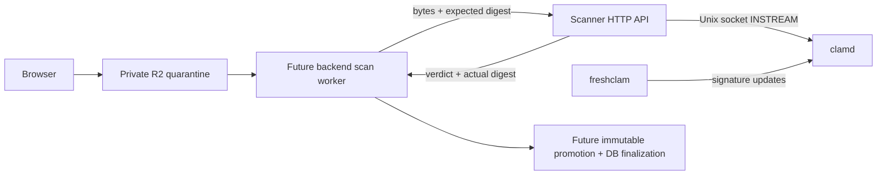

# 08B extension — Independent ClamAV scanner

**Status:** Proposed — design only; implementation, paid hosting and upload activation are not authorized by this document.

**Plan:** [Implementation plan](../plan/08b-independent-scanner.md)

**Parent:** [Phase 08 specification](08-rich-messaging.md), sections 4–5.

## 1. Goal and scope

Build a separately deployable scanner that accepts bounded bytes over an internal
HTTP API and returns a malware verdict bound to their actual length and SHA-256.
It runs locally with Docker and can later run as a Render Private Service or on a
VPS. It must operate without the chat server, PostgreSQL, R2 credentials or public
user accounts. The chat backend retains attachment authorization, durable retries,
quotas, type validation, promotion and lifecycle decisions.

This is a proposed resumption of the previously pending scanner work. The user
has requested design and planning; no scanner is implemented or activated yet.
Existing uncommitted staging acceptance changes are separate work and must survive.

Success has two separate boundaries:

1. **Standalone scanner:** real ClamAV clean/EICAR/error/limits/restart checks pass;
   an operator can deploy it independently. This document's implementation scope.
2. **08B release:** a later backend integration proves exact-byte R2 retrieval,
   validation, scan, immutable promotion, fenced DB finalization and lifecycle.
   A running scanner alone cannot open upload admission or complete 08B.

No public scanning product, URL-fetch endpoint, webhook, job database, broker,
result cache, frontend endpoint, archive upload support or automatic paid resource
creation is included. Antivirus detects known threats; `clean` is not a guarantee
that a file is safe or a substitute for file-format validation.

## 2. Options and chosen proposal

| Approach | Benefit | Cost / limitation |
| --- | --- | --- |
| Go HTTP wrapper + local clamd/freshclam | Typed bounded API, auth, digest verification, portable backend integration | Small wrapper and container lifecycle to maintain; selected proposal |
| Backend directly calls remote clamd | Less wrapper code | Clamd protocol has no authentication; couples backend to engine protocol/limits |
| Scanner fetches R2 objects itself | Less backend byte forwarding | Adds R2 credentials, object identity, URL/SSRF and promotion coupling to scanner |

Use the existing Go module with a new `cmd/scanner` binary and focused
`internal/scanner` package. Reuse existing zerolog; prefer Go standard library
HTTP and Unix sockets. No new Go dependency is planned. No chat/domain packages
are imported. A separate container image contains the Go wrapper, `clamd` and
`freshclam`. The backend's existing scratch image stays independent.



Only the scanner API, engine and updater are built by this plan. R2/backend paths
in the diagram are the future integration contract.

## 3. Internal HTTP contract v1

HTTP responses use JSON and `Cache-Control: no-store`; scan responses are at most
4 KiB. No CORS headers or browser access are needed. A separate service credential
is mandatory: `Authorization: Bearer <SCANNER_API_TOKEN>`, compared in constant
time. It is unrelated to user JWTs. Do not put it in URLs or logs.

| Method/path | Authentication | Meaning |
| --- | --- | --- |
| `GET /livez` | None, private network only | 200 while wrapper is serving; no engine/version disclosure |
| `GET /readyz` | None, private network only | 200 only if not draining, engine responds and loaded database is fresh; otherwise 503 |
| `POST /v1/scan` | Service token | Synchronous scan of raw body; no server-side durable job |

Scan input: `Content-Type: application/octet-stream`, exact `Content-Length` from
1 to 10,485,760 bytes, `X-Content-SHA256` as 64 lowercase hexadecimal characters.
Chunked/unknown-length requests receive 411. Reject nonidentity Content-Encoding
and unsupported content type with 415. Missing/malformed digest receives 400.
A declared size above the maximum receives 413 before body allocation; truncated
or extra body bytes within the HTTP message are never accepted as a complete file.
Transport framing remains the HTTP server's responsibility; count the delivered
body and compare it with declared length, without reading into a subsequent request.

Authenticate, validate headers, acquire the single scan slot without waiting, then
read into a bounded memory buffer (limit + 1), count and hash actual bytes. Compare
the actual digest before submitting exactly that buffer to ClamAV. Never scan a
caller-supplied path or fetch a caller-supplied URL. Buffer is request-scoped, not
persisted or cached. Clamd may use its own bounded temporary directory.

Completed clean response (200):

```json
{"verdict":"clean","sha256":"<actual 64-hex digest>","size_bytes":123,"engine":"clamav","scanned_at":"<UTC RFC3339>"}
```

Completed detection also returns 200 with `verdict: "infected"`; this includes
ordinary malware/heuristic detections. Do not expose raw engine reports or signature
names. SHA-256 and size always describe the submitted, validated bytes.
`scanned_at` is response completion time, not a certificate or persistent identity.

| Status | Stable JSON error code | Caller treatment |
| --- | --- | --- |
| 400 | `invalid_request` | Fix malformed headers/body |
| 401 | `unauthorized` | Fix service credentials; do not retry indefinitely |
| 411 / 413 / 415 | `length_required` / `payload_too_large` / `unsupported_media_type` | Fix request |
| 422 | `digest_mismatch` | Never accept bytes; investigate source integrity |
| 422 | `scan_limit_exceeded` | Never treat unscanned/partially scanned content as clean |
| 429 | `scanner_busy` | `Retry-After: 1`; backend schedules bounded durable retry |
| 503 | `scanner_unavailable` | Engine absent/stale, startup/reload/drain or malformed engine response; bounded retry |
| 504 | `scan_timeout` | Bounded retry; no clean verdict |
| 500 | `internal_error` | Fail closed; safe diagnostic only |

Errors use `{"error":{"code":"..."}}`, without `verdict`. Cancellation closes
engine I/O; disconnected callers may receive no response. Repeating a scan is safe:
there are no application side effects, deduplication records or durable results.
Verdicts can legitimately change after signature updates; backend retry safety
comes from its immutable byte identity and DB fencing, not cached scanner results.

## 4. Engine, bounds and freshness

Use Unix socket `zINSTREAM` framing: 32-bit big-endian chunk sizes, bytes, final
zero chunk; bounded NUL-terminated reply, maximum 4 KiB. Use a fresh connection for
each command. Accept clean only for the exact successful `stream: OK` response
after the whole validated buffer has been sent. EOF, unknown commands, errors,
missing terminators, oversized replies and timeouts never mean clean.

Clamd configuration is part of the service contract: StreamMaxLength=10 MiB,
MaxFileSize=10 MiB, MaxScanSize=50 MiB, MaxRecursion=8, MaxFiles=100,
MaxThreads=1, MaxQueue=2 and AlertExceedsMax=yes. Map
`Heuristics.Limits.Exceeded` detections to `scan_limit_exceeded`, not clean or a
confirmed malware verdict. Keep parser/signature defaults enabled; do not trim
signature databases to force deployment into 512 MB. Real engine tests must prove
these limits for the pinned supported image; an unsupported directive fails rollout.

Freshness proposal: reject loaded daily databases older than 72 hours. Container
uses UTC; inspect the daemon's loaded VERSION database timestamp (not file mtime
or the last updater attempt). Parse the supported image's exact VERSION format;
missing/unparseable timestamps or timestamps more than 5 minutes in the future
fail readiness/scans. Recheck before and after scanning, require an unchanged
loaded database version, and fail closed if it reloads or becomes stale mid-request.
These checks observe loaded metadata; they do not establish a cryptographic scan
attestation. Readiness probes have a 2-second deadline and do not consume the scan
slot. Scan requests have an overall 20-second deadline including upload/checks;
engine scan I/O is capped at 15 seconds within the remaining request budget.

One scan is admitted at a time; no application wait queue. HTTP ReadHeaderTimeout
is 5 seconds, ReadTimeout 20 seconds, WriteTimeout 25 seconds, IdleTimeout 30
seconds, MaxHeaderBytes 16 KiB. Oversized/slow/unauthenticated requests cannot
allocate a per-file buffer before auth and admission. Limits are initial safety
budgets, not measured throughput guarantees. Gateway connection-rate limits and
network isolation remain deployment responsibilities.

## 5. Configuration and lifecycle

New scanner-specific configuration (separate from backend Config):

| Variable | Default / validation |
| --- | --- |
| `SCANNER_LISTEN_ADDR` | `127.0.0.1:8091`; Render/Compose explicitly use `0.0.0.0:10000` |
| `SCANNER_API_TOKEN` | Required, at least 32 bytes; no default or committed value |
| `SCANNER_CLAMD_SOCKET` | `/run/clamav/clamd.sock`; Unix socket only |
| `SCANNER_DATABASE_MAX_AGE` | `72h`; positive, no greater than 72h |

Other limits above are named constants in v1. Do not add knobs to increase the
file size, concurrency or time budget without a later reviewed capacity change.
No fallback to backend secrets, cloud credentials or implicit Render PORT parsing.

Startup validates config, starts wrapper, updater and daemon under one supervisor;
readiness remains false until signatures load. The wrapper does not execute shell
commands for individual scans. PID1 forwards signals and reaps children. On SIGTERM,
mark draining, refuse new work, drain existing HTTP requests for at most 25 seconds,
then cancel outstanding engine I/O and stop/reap child processes. A critical child
exit terminates the container; stale signatures also fail readiness. Resource
ownership and cancellation must be covered by tests.

Log safe outcome/category, duration and bounded request correlation only. Never
log bodies, hashes, filenames, tokens, raw engine replies or full request headers.
No high-cardinality metrics or external telemetry service is introduced.

## 6. Deployment and cost boundary

Local Compose exposes only `127.0.0.1:8091`; clamd's socket/TCP is never published.
Use a service-owned temporary directory with bounded storage and restrictive
permissions; scanner code does not retain files. Persist only signatures at
`/var/lib/clamav`, not submitted content. Disable debug/core dumps in the container
runbook; do not claim in-memory bytes are securely erased by Go.

Render target: one paid Docker Private Service in the backend's region; the
backend may remain Free. Use the internal hostname and service-token auth; HTTP
is confined to Render's private network. On other hosts require HTTPS or an
explicitly secured private tunnel, with no redirects. Start with at least 4 GB
RAM and measure reload peaks; CPU, disk size, exact image digest and current cost
must be recorded before provisioning. Use a supported ClamAV release and pin the
resolved image digest during implementation. Persistent signatures avoid repeated
full database downloads. Verify startup with the attached disk as well as empty
storage. Render Free/512 MB is not a supported scanner target.

Do not provision paid compute/disks without explicit user approval of actual cost.
No availability or throughput SLA follows from this proposal.

## 7. Future backend integration boundary

Existing `attachment.ObjectStore` only signs PUT/deletes; cleanup worker only
claims cleanup. No scan consumer, promotion, ready/attached/download or binding
exists. This plan must not activate `attachment_scan` claims, change schema or
flip upload admission.

A later 08B slice must read and verify bounded exact quarantine bytes, enforce
JPEG/PNG dimensions/decoding or UTF-8 text validation, and submit those bytes with
a server-computed digest/length. Validate response shape, actual digest/size and
`clean` verdict; promote the same verified bytes to create-only final identity.
Untrusted HTTP200 without valid fields never authorizes ready/download.

Reuse the existing durable outbox rather than adding a scanner queue. Existing
leases are 30 seconds and retry attempts cap at eight; the complete read/scan/
promotion/finalize budget must be designed and tested against lease fencing before
integration. It cannot be assumed to fit merely because this API times out at 20
seconds. State CAS, current ownership/cancellation, crash after promotion, cleanup
and broker/notification purpose isolation remain backend responsibilities.

## 8. Verification and references

Standalone acceptance requires unit/race tests with a fake Unix daemon and real
container tests for clean bytes, official EICAR test bytes, boundary size, limit
rejection, stale/missing signatures, reload and daemon restart. Never commit malware
or EICAR bytes into the repository/image; create the harmless test fixture only
in a temporary test directory or memory. Do not send test fixtures to public rooms.

- [Clamd protocol](https://docs.clamav.net/manual/Usage/ClamdProtocol.html): INSTREAM framing and bounded stream semantics.
- [Clamd configuration](https://github.com/Cisco-Talos/clamav/blob/main/etc/clamd.conf.sample): limits and AlertExceedsMax; confirm against the pinned release.
- [ClamAV Docker](https://docs.clamav.net/manual/Installing/Docker.html): RAM, updates and signature persistence.
- [ClamAV scanning](https://docs.clamav.net/manual/Usage/Scanning.html): unauthenticated native TCP protocol.
- [Render Private Services](https://render.com/docs/private-services) and [private networking](https://render.com/docs/private-network): internal service connectivity.
- [Render compute](https://render.com/docs/compute-plans): supported memory sizes; cost reviewed at deployment time.
