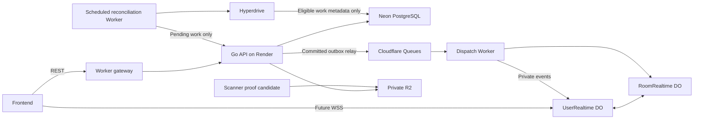

# Cloudflare Platform Extension Specification

**Status:** Proposed — design only; runtime remains Render + Neon
**Decision date:** 2026-10-12
**Execution plan:** [Cloudflare platform plan](../../plan/extensions/cloudflare-platform.md)

## 1. Intent and decisions

The user wants Cloudflare to be the preferred ecosystem for new infrastructure,
while retaining the existing Go API on Render and PostgreSQL on Neon initially.
A small paid plan around USD 5/month is acceptable. This is permission to plan;
it does not provision services or establish a total monthly spending limit.

This is an optional extension to the existing roadmap, not a replacement for it.
The primary [08 plan](../../plan/08-rich-messaging.md) and
[09 plan](../../plan/09-scale-observability.md), their statuses, dependencies and
verification records remain authoritative. The Cloudflare topology below is a
proposed alternative to evaluate for unfinished 08B and deferred 09B–09D;
it does not activate those slices or supersede their Redis design automatically.
Record explicit acceptance and reconcile conflicting requirements before adopting
an alternative. Phase 05 verification remains a realtime release prerequisite.

Workers using TypeScript for Cloudflare bindings is a proposed implementation
choice to review. Go retains domain mutations, authorization and concrete
application wiring. The source contracts are [08](../08-rich-messaging.md),
[09](../09-scale-observability.md) and [05](../05-room-membership-roles.md).

Acceptance: introduce services incrementally, demonstrate idempotent recovery and
privacy, record measured cost, preserve REST recovery, and keep rollback available.
No runtime code, schema, dependency, account configuration or deployment changes
are included in this planning pass.

## 2. Approaches considered

| Approach | Benefit | Cost / constraint | Decision |
|---|---|---|---|
| R2 and a thin Worker around the current Go process | Smallest change | Realtime and jobs still depend on Render uptime | Initial baseline |
| Add Queues and Durable Objects incrementally | Cloudflare-managed orchestration and socket coordination; retains Go/PG | TypeScript component, cross-service authorization and recovery work | Recommended target |
| Move API and DB entirely to Cloudflare | Fewer external providers | Go runtime/deployment and PostgreSQL migration become separate projects | Deferred by user choice |

## 3. Service assignments

| Responsibility | Preferred service | Boundary / alternative |
|---|---|---|
| Existing REST/domain API | Render Go Web Service, one Free instance | Existing accepted exception; cold starts remain |
| Accounts, memberships, messages, inbox and outbox | Neon PostgreSQL | Keep transactions/FTS; do not migrate them to D1/DO storage |
| Private file bytes | Cloudflare R2 | Existing adapter; provider checks and scanning still required |
| Edge ingress and internal dispatch | Cloudflare Workers | Proposed; enforce auth in Go as well as at edge |
| Asynchronous transport | Cloudflare Queues | Work distribution, not automatic subscriber broadcast |
| Socket coordination, presence, typing, strict user admission | SQLite-backed Durable Objects | Application implementation required; not a Redis protocol adapter |
| Worker-to-Neon metadata access | Hyperdrive | Connection acceleration/pooling, not a replacement database |
| Job reconciliation | Scheduled Worker | Detect real pending work; never ping Render just to keep it awake |
| Worker/DO telemetry | Cloudflare observability | Validate pricing, retention and redaction at rollout |
| Go metrics/traces | Existing 09A instrumentation | External collector such as Grafana Cloud is a candidate; prove integration first |
| Malware scanner | Proof: ClamAV in Cloudflare Containers | Budget/size/signature-update proof required; otherwise compare dedicated Linux host or private scanning API |
| Frontend/static hosting | Workers Static Assets or Pages, optional | Separate frontend repository/task; no migration in this backend plan |

Provider facts checked on 2026-10-12:

- Workers Paid has a USD 5/month minimum and additional usage charges. This is
  not a USD 5 cap for R2, Containers, storage or all telemetry.
  [Workers pricing](https://developers.cloudflare.com/workers/platform/pricing/).
- Queues has at-least-once delivery, can reorder messages, and has one active
  consumer per queue. A consumer must explicitly dispatch to all relevant targets.
  [Delivery](https://developers.cloudflare.com/queues/reference/delivery-guarantees/),
  [topology and ordering](https://developers.cloudflare.com/queues/reference/how-queues-works/).
- On Paid, queue retention defaults to four days and can be configured up to
  fourteen days. Queue retention does not replace the PostgreSQL recovery source.
  [Queues pricing](https://developers.cloudflare.com/queues/platform/pricing/).
- Durable Object hibernation can preserve incoming sockets while memory resets;
  connection attachments and durable checkpoints must reconstruct state.
  [WebSocket hibernation](https://developers.cloudflare.com/durable-objects/best-practices/websockets/).
- KV is eventually consistent; the Workers rate-limit binding is permissive and
  local to an edge location. Neither establishes strict global authorization,
  connection caps, quotas or revocation.
  [KV](https://developers.cloudflare.com/kv/concepts/how-kv-works/),
  [rate limits](https://developers.cloudflare.com/workers/runtime-apis/bindings/rate-limit/).

## 4. Target topology and ownership

This is the proposed final topology, not the topology currently deployed.
The same Workers application may contain gateway, dispatcher and scheduled
handlers; split deployments only when permissions or scaling justify it.

Go/PG own business truth. DO storage owns only transport checkpoints, connection
attachments and ephemeral coordination. Workers do not become a second chat
service. Read/write only explicitly granted outbox/operational metadata through
Hyperdrive; domain writes continue through authenticated Go services.

## 5. Jobs and operation while Render sleeps

1. A Go mutation commits the domain record and its immutable outbox intent together.
2. The Go relay publishes content-free references through the Queues API. Publisher
   lease/fence and progress are separate from notification and cleanup progress.
3. A Queue consumer invokes a bounded, service-authenticated Go job handler for
   domain work. Go rechecks the source, claims a lease and commits the effect with
   progress. Redelivery must not duplicate the effect.
4. A scheduled Worker checks a narrowly granted eligible-work view through
   Hyperdrive every five minutes. It wakes the Go job handler only when durable
   work is eligible. No periodic request is sent to an idle Render origin.
5. Render cold starts, origin outages, queue expiry and exhausted retries remain
   possible. Reconciliation uses PostgreSQL state, not absence of Queue messages,
   to determine completion. Every retry has a bound; dead letters remain visible.

Only one owner may complete each delivery purpose. During migration, Go's existing
notification/cleanup loops remain authoritative; a Worker triggers those same
lease-protected paths rather than creating a parallel effect implementation.
The scheduler's Neon queries may prevent DB suspension and incur compute usage;
measure this before enabling it. Five minutes is a proposed reconciliation cadence,
not a delivery SLA. Queue callbacks are genuine work, not synthetic keepalives.

Queue publication acceptance alone must not mark transport delivery complete.
Add separate enqueued/accepted progress: an accepted receipt is persisted after
DO durable handoff or the Go job effect. A lost receipt/redelivery is harmless.
Expired messages and DLQ entries can be re-driven from unresolved PostgreSQL
progress without deleting the shared outbox or changing domain history.

## 6. Realtime migration contract

The current Go Hub remains the production path until the Cloudflare path passes
its gates. Workers proxying the existing Go WebSocket alone does not make the
socket independent of Render lifecycle.

Proposed object roles:

- `UserRealtime`: one logical DO per authenticated user/environment/incarnation;
  owns that user's sockets, private event delivery and strict per-user admission.
  Multiple tabs and multiple joined rooms retain the current connection model.
- `RoomRealtime`: one logical DO per room/environment/incarnation; owns ordered
  room coordination and membership-generation fences, and dispatches to the
  corresponding user objects. No user/room names or content in routing keys.

Go issues a one-use opaque connection ticket with a 30-second lifetime through
an authenticated REST endpoint. Worker redemption is authenticated to Go, which
consumes the stored ticket hash atomically. The ticket is carried in a redacted
WebSocket subprotocol, not a logged query string. Workers do not receive JWT
signing secrets. Join authorization returns current membership generation from
Go; unknown/unavailable authorization denies admission.

Durable event envelopes contain schema/version, event ID, scope/aggregate ID,
sequence, resource revision, environment/incarnation and references only. Room
membership controls and room data share an authoritative ordered room lane.
Queue arrival order does not define that order. Missing controls, unknown schema,
wrong generation or excessive lag pause delivery until a transaction-consistent
snapshot/replay reconciles the lane. A bounded buffer accepts at most 64 pending
references per lane for at most 30 seconds; overflow requests resync and closes
affected subscriptions rather than emitting unauthenticated data.

Queue ACK follows a durable handoff and accepted receipt, never mere in-memory
socket enqueue. Browser delivery remains best-effort with REST history/inbox
recovery; no exactly-once browser delivery is promised. Hydrate only an authorized
exact revision; obsolete events become content-free skips. Newer text is never
substituted into an old event sequence.

Revocation is a cutover gate: distinguish DB commit, control acceptance and
already in-flight delivery. Prove the existing effective-revocation/privacy
contract under delayed controls, reordered events and concurrent joins. If that
contract cannot be preserved, keep Go sockets; do not silently weaken it.
Persist enough connection attachments to recover after hibernation, but revalidate
authorization before restoring subscriptions. Short TTL/alarms clear abandoned
presence/typing/admission leases; disconnect callbacks alone are insufficient.

Preserve existing event names, string room IDs, REST APIs, cursor pagination and
Phase 7 typing/read semantics. Cutover uses one authoritative websocket transport
per cohort; no dual broadcasts that manufacture duplicate notifications. Browser
reconnect must handle abnormal close as well as planned shutdown.

## 7. Attachments and scanning

Keep the 08B exact-byte, create-only quarantine, immutable promotion, quota,
short-lived download and lifecycle cleanup requirements. R2 object notifications
can wake a Queue consumer, but the event's key/ETag is not a clean verdict or
proof of reservation ownership. Reconcile it to server-generated reservation
metadata before processing. [R2 notifications](https://developers.cloudflare.com/r2/buckets/event-notifications/).

Cloudflare offers WAF malicious-upload detection on Enterprise with a paid add-on.
That does not establish an affordable asynchronous scanner for the current direct
R2 upload flow. [Cloudflare scanning](https://developers.cloudflare.com/waf/detections/malicious-uploads/).

Investigate ClamAV in Containers first: pin signatures/engine version, cap instance
count and runtime, measure exact-byte download/scan/hash/promotion, failure isolation,
update freshness and total bill. Containers have separate metered resources;
ClamAV recommends substantial RAM. Neither a free scanner binary nor Workers Paid
makes the scanner free to operate.
[Containers cost](https://developers.cloudflare.com/containers/platform/pricing/),
[ClamAV requirements](https://docs.clamav.net/).

If this fails the technical or cost gate, document a dedicated Linux scanner or
private commercial scanning API comparison, including file confidentiality and
cost. A public sample-sharing API is not assumed acceptable for private chat files.
Scanner provider remains unselected. Admission stays closed until scanner and R2
proofs pass; notifications and realtime can proceed independently.

## 8. Authentication, failure and rollback

Internal callbacks are separate from user JWT routes, use rotating service HMAC
keys, a body hash, environment/audience, timestamp and replay protection. Public
Render access must not bypass those controls. No token, DSN, object URL, file bytes
or message content in logs, queues, traces or metrics labels. Restrict SQL roles,
Cloudflare API tokens and bucket permissions to the actual task.

No automatic fallback from an uncertain DO authorization state to cached KV.
Origin outage denies new protected operations; existing durable data stays in PG.
Rollback disables new edge admission, drains/closes its sockets, restores the Go
route, and makes clients rejoin and fetch durable state. Keep outbox/receipts and
schema; do not roll migrations down or clear DO/queue state to hide lost work.
Recovery incarnation fences late messages after restore.

## 9. Cost and observability

Start with Workers Paid as the approximate USD 5 base subscription. Record Worker
requests/CPU, DO requests/active duration/storage, Queue operations/retries, R2
storage/operations, Neon activity and any Containers/collector cost separately.
Use hibernation where eligible, bounded fanout/retries/connections, batch processing
and scanner scale-to-zero. Budget alerts do not constitute a universal hard cap.

Cloudflare-native logs/traces cover Cloudflare components. Existing Go Prometheus/
OTLP output needs a proven destination; native Cloudflare export documentation
alone does not establish arbitrary Go OTLP ingestion or Prometheus scraping.
Evaluate an external collector only for that gap, with the same redaction and
budget rules. [Cloudflare telemetry export](https://developers.cloudflare.com/workers/observability/opentelemetry-export/),
[Grafana candidate pricing](https://grafana.com/pricing/).

## 10. Release gates and open decisions

- Phase 05 PostgreSQL/role/revocation verification before realtime cutover.
- Real R2/CORS/conditional-write proof and a chosen scanner before uploads open.
- Duplicate/out-of-order delivery, accepted receipts, queue expiry and PG replay.
- DO hibernation, crash, stale membership, account deletion and slow clients.
- Origin sleep/unavailable, Worker redeploy, browser reconnect and rollback.
- Measured hot-room capacity, retention, cost and operational ownership.

No milestone is Done because this document exists. Confirm the proposed services,
TypeScript component and phased scope before implementation. Freeze package
versions/configuration and exact SQL privileges in each capability task; external
credentials, scanner selection and spend beyond the small base plan remain gates.
